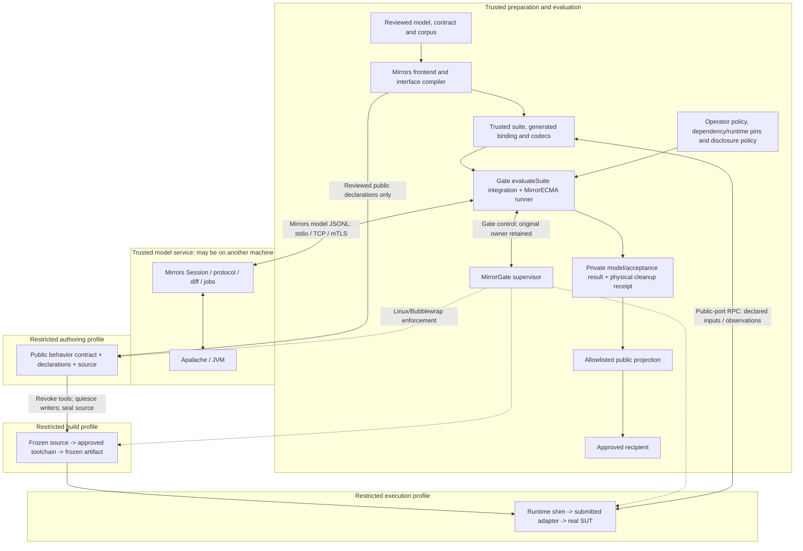

# Mirrors and MirrorGate: trust, acceptance and operating limits

Reviewed 2026-10-28 at Mirrors `ed86c2c` and MirrorGate `5055d91`. This is a
source/contract review with subsequent runtime remediation, not new platform or
framework qualification. The runtime changes and exact validation limits are
recorded in the [October 28 evidence](../Plans/mirrors-gate-runtime-review-evidence-20261028/README.md).
The [current status](current-status.md) and newest [checkpoint](../CHECKPOINTS.md)
retain authority over exact accepted identities.

## Trust and execution paths

The compiler, generated evaluator binding, client codecs, approved suite and
configuration are part of the trusted evaluation path. Generated code performs
representation conversion and dispatch; it does not establish that a submitted
observer reads the real system under test (SUT).



Boxes denote authority and permissions, not permanent machines or separate
services. Model transport, Gate control and public-port RPC are three distinct
protocols. Gate owns the optional trusted integration; MirrorECMA core remains
independent of Gate. Submitted code executes only in restricted build/execution
profiles, including its import-time initialization. The compiler's private suite
bundle is never the authoring bundle.

The [Gate architecture](../../MirrorGate/docs/architecture.md),
[worker protocol](../../MirrorGate/docs/worker-protocol.md), and
[workflow contract](../../MirrorGate/integrations/mirrorecma/WORKFLOW.md) own the
implementation details. The [remote guide](../../MirrorGate/docs/remote-mirrors.md)
describes independent placement of the model service and Gate controller.

## Acceptance requires evidence from the real implementation

Reported-state conformance, observation fidelity, coverage and cleanup are
separate checks. A successful replay alone is insufficient evidence for a
truthful adapter. For application acceptance:

1. Freeze the suite/model closure, ordered corpus, generated binding, acceptance
   requirements, observer/probe closure, implementation, runtime and Gate policy.
2. Run a correct baseline and a declared finite set of real SUT faults through
   the same observer. Each case gets fresh state and independently joined cleanup.
3. Check observations against an independent probe of real application facts.
   Include a shadow-observer control: replay may match while the probe disagrees;
   that result must fail application acceptance.
4. Count a mutant only when its declared behavioral mismatch occurs with the
   required cleanup. Timeout, crash, codec error and unavailable isolation are
   infrastructure/implementation failures, not fault detections.

Use the existing [mutation-fidelity contract](../../MirrorECMA/docs/mutation-fidelity-guide.md)
and Gate [campaign integration](../../MirrorGate/integrations/mirrorecma/src/campaign.ts).
These controls establish finite evidence for a protected closure. Neither the
compiler nor the sandbox can prove universal observer honesty. The current
`evaluateSuite` conformance outcome must not be relabeled as having passed these
additional checks unless the corresponding campaign evidence is retained.

## Cleanup and restart are different guarantees

The original Gate owner survives authoring, preparation, negotiation and
evaluation until physical cleanup has been observed. A model mismatch remains
the primary result even if cleanup also fails; overall success requires confirmed
cleanup. Closing a model connection does not establish Gate cleanup.

After owner/controller loss, mark the evaluation interrupted or cleanup
unconfirmed. Do not reconnect and adopt old authority or reconstruct a pass from
missing files or a reused PID. With an operator-selected durable state root,
Gate's offline recovery inspects and reclaims exact owned resources. Recovery
observations remain separate from the original evaluation receipt.

The [implemented recovery profile](../../MirrorGate/docs/sandbox/recovery-design.md)
does not resume abandoned runs. Journal v2 now links a published process to its
exact owned cgroup resource/identity and delegation. Only confirmed group cleanup
with a durable observed-empty result can reclaim the linked process; retained
terminal counters support interrupted-recovery retries. Legacy v1, unpublished
membership and stale/foreign claims remain ambiguity-only. The real
delegated-cgroup tier is unavailable on this host. An unattended deployment that
requires process reclamation after controller loss is therefore **not admitted
by the evidence recorded here**. Admission requires a new profile-specific
crash/descendant/reclaim run; filesystem recovery alone cannot satisfy it.

## Resource admission and retention

Budget each layer independently. The optional evaluation service supplies some
of these bounds; direct library callers must supply their own admission/retention
owner. A replay timeout is a wait budget, not an OS quota or cleanup observation.

| Resource | Existing mechanism | Remaining scope requirement |
| --- | --- | --- |
| Active evaluations, HTTP requests, retained service runs and lifetime starts | [Service limits](../../MirrorGate/integrations/mirrorecma/service/index.d.mts) | Explicit positive limits for the selected service epoch; direct callers need equivalent admission |
| Worker processes, CPU and memory | [Gate backend limits](../../MirrorGate/docs/sandbox/linux-bubblewrap.md) | Default rlimits are per process or UID; aggregate guarantees require separately admitted delegated-cgroup enforcement and real acceptance |
| Worker messages, stdout/stderr and temporary storage | Gate framing/output/profile limits | Approved writable source/output roots also need operator storage and retention budgets; per-file bounds do not bound aggregate disk use |
| Mirrors live jobs and connection workers | [Shared job store](../Shell/Jobs/Store.lean), bounded connection queue, separate pure retention admission | The default 256 retained entries and 262,144 encoded bytes per outcome bound retained outcome data to 64 MiB. Admission rejects exhaustion and converts storage-oversized outcomes to explicit failures; wire delivery keeps its separate limit. This is not whole-process RSS |
| Private receipts, artifacts and qualification bundles | Explicit persistence and operator retention policy | Record maximum bytes/count, retention period and cleanup owner; immutable publication is not a retention policy |

Shared or unattended deployment acceptance requires a measured whole-process and
storage envelope, with rejection at exhaustion and reclamation after cancellation.
This is a requirement for that stronger profile, not a claim that every library
entry point already implements such an envelope. No aggregate guarantee is
inferred from the topology or from a passing per-process test.

## Public feedback and adaptive attempts

Keep full diagnostics, expected states, corpus coordinates, probe results and
trusted receipts private. Gate's [public projection](../../MirrorGate/integrations/mirrorecma/src/receipt.ts)
defaults to a run reference, outcome and independent cleanup status. Counts,
failure stages and implementation identities require explicit trusted policy.
Use the minimum feedback needed for the selected workflow.

A held-out evaluation policy must name the immutable suite/corpus revision,
allowed recipients/fields, attempt budget and owner, and renewal/reset rule.
Charge accepted evaluations, including failures and cancellations, rather than
only successful verdicts. Polling or retrying the same service start key is not
a new evaluation. The service's epoch-local lifetime-start bound and rate limits
do not provide a persistent per-author/private-corpus disclosure budget across
restarts or multiple service instances. The service now provides an explicit
persistent per-author/corpus budget: select `requirePersistentBudget`, use the
same operator-owned directory across instances, and set each binding's immutable
scope and attempt limit. Exclusive synchronized spent markers precede execution
and survive restart; failures/cancellation never refund attempts. Even a Boolean
verdict leaks some information.

For example, a single private attempt uses a persistent budget and minimal
service-level disclosure as well as finite in-memory limits:

```js
const service = await startEvaluationService({
  requirePersistentBudget: true,
  callers: [{
    id: approvedAuthorRef,
    token: operatorToken,
    bindings: [{
      suiteRef: approvedSuiteRef,
      implementationRef: approvedImplementationRef,
      evaluate: approvedEvaluatorCallback,
      attemptBudget: {
        directory: operatorOwnedBudgetDirectory, // existing, mode 0700
        authorRef: approvedAuthorRef,
        corpusDigest: approvedPrivateCorpusSha256,
        maxAttempts: 1,
      },
      disclosure: {},
    }],
  }],
  limits: {
    activeRuns: 1,
    activeRunsPerCaller: 1,
    lifetimeStarts: 1,
    retainedRuns: 1,
    retentionMs: 300_000,
  },
});
```

The accepted start consumes the persistent budget regardless of its eventual
outcome. Restart, token rotation or a different implementation cannot refund it
when using the same directory/scope. Private mode strips optional fields unless
the binding explicitly enables them. Deleting/replacing the directory constitutes
a new operator authorization, not recovery; direct library callers require their
own equivalent budget owner. See the [persistent budget contract](../../MirrorGate/docs/evaluation-service-contract-v1.md#persistent-private-evaluation-attempts).

## Profile decision

| Intended use | Admission boundary |
| --- | --- |
| Supervised finite local or Gate replay | Existing conformance, coverage, lifecycle and selected backend gates; report observation-fidelity evidence separately |
| Application fault-detection claim | Add the protected observer/probe and exact-mismatch campaign above, with explicit denominators |
| Private finite evaluation, including across service restarts | Require persistent author/corpus budget and approved feedback; keep all trusted evidence private and preserve the budget directory |
| Shared unattended execution with crash reclamation | Requires independently accepted whole-host aggregate/storage and native process-recovery mechanisms; source and diagnostic tests alone grant no such acceptance |

These decisions constrain the claim made from a result. They do not silently add
a new wire capability, retrofit historical qualification, or provision host
cgroups, storage quotas or services.
